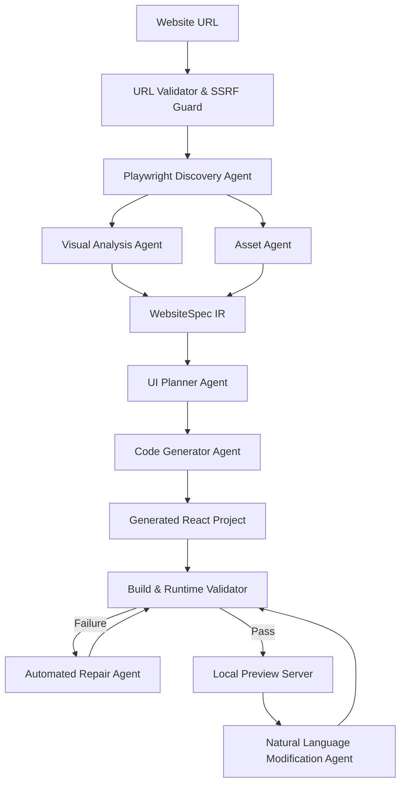

# Replicate.AI ⚡
### AI-Powered Frontend Website Reconstruction Agent

> **"Give it a URL. Get a working frontend. Modify it with AI."**

Replicate.AI is an autonomous engineering agent that accepts any publicly accessible website URL and automatically reconstructs its frontend and UI as a **NEW, completely independent React + TypeScript + Tailwind CSS application**.

> [!IMPORTANT]
> **Zero-Iframe Guarantee**: The output is NEVER an iframe or proxy of the original website. Replicate.AI generates independent React components, styles, design tokens, and local assets running in an isolated project sandbox.

---

## 🚀 Key Features

- **🌐 Multi-Viewport Playwright Discovery**: Launches headless Chromium to render the live website at 1440x900 (desktop) and 390x844 (mobile), extracting DOM structure, computed CSS properties, typography, and responsive rules.
- **🛡️ Enterprise SSRF Protection**: Full security boundary blocking loopback (`127.0.0.1`), private RFC 1918 subnets, cloud metadata (`169.254.169.254`), and unsafe URI schemes (`file://`, `javascript:`, `data:`).
- **📋 WebsiteSpec Intermediate Representation (IR)**: Decoupled Pydantic schema enforcing design tokens, component hierarchy, responsive behavior, and asset mappings.
- **🖼️ Asset Extraction with Vector Fallbacks**: Downloads publicly accessible images and SVGs. In case of broken links or CORS restrictions, synthesizes crisp vector SVG placeholders.
- **⚛️ Independent React Code Generation**: Generates clean, modular React 18 TypeScript components (`Navbar.tsx`, `Hero.tsx`, `Features.tsx`, `Testimonials.tsx`, `CTA.tsx`, `Footer.tsx`) with Tailwind CSS.
- **🛠️ Automated Build Validation & Self-Healing Repair**: Runs production builds, starts dynamic preview servers, tests runtime console errors, and automatically invokes the **Repair Agent** (up to 3 iterations) to resolve compilation errors.
- **👁️ Approximate Visual Similarity**: Computes structural and visual similarity percentage comparing original vs generated screenshots.
- **💬 Natural Language AI Modification**: Modify the generated website conversationally (e.g. *"Change primary color to emerald and make the navbar sticky"*). Updates only targeted files with version tracking (v1, v2, v3) and instant rollback support.
- **📊 Real-Time Observability**: Live Server-Sent Events (SSE) telemetry, tracking LLM invocations, token consumption, pipeline duration, and build status.

---

## 🏗️ Multi-Stage Agent Pipeline



---

## 💻 Tech Stack

- **Dashboard / Control Panel**: Next.js 15+, React 19, TypeScript, Tailwind CSS, Lucide Icons
- **Agent Orchestration**: Python 3.13, FastAPI, Pydantic v2, SQLAlchemy, aiosqlite, Uvicorn
- **Browser Automation**: Playwright (Headless Chromium) + BeautifulSoup / lxml fallback
- **Vision & Image Processing**: Pillow (PIL)
- **Database**: SQLite (projects, versions, validation results, telemetry)
- **Code Execution**: Dynamic port allocation with isolated Vite + React runtime

---

## 📦 Project Structure

```
replicate-ai/
│
├── apps/
│   └── dashboard/                # Next.js 15+ Control Dashboard
│       ├── app/                  # App router (layout, globals.css, page)
│       ├── components/           # Navbar, UrlInputHero, ProjectDetailView, etc.
│       └── next.config.js        # API & screenshot proxy rewrites
│
├── backend/
│   ├── app/
│   │   ├── agents/               # 8 Specialized Autonomous Agents
│   │   │   ├── discovery.py      # Playwright browser inspection
│   │   │   ├── analysis.py       # DOM & visual metric synthesis
│   │   │   ├── asset.py          # Media downloader & SVG fallback engine
│   │   │   ├── planner.py        # WebsiteSpec IR planner
│   │   │   ├── generator.py      # React TypeScript code generator
│   │   │   ├── validator.py      # Build, runtime & preview validation
│   │   │   ├── repair.py         # Automated error repair agent
│   │   │   ├── modifier.py       # Natural language code modification
│   │   │   └── orchestrator.py   # State machine & SSE pipeline driver
│   │   ├── browser/              # Playwright service & SSRF security
│   │   ├── models/               # SQLAlchemy SQLite database models
│   │   ├── schemas/              # Pydantic WebsiteSpec IR & project models
│   │   ├── services/             # LLMProvider, PreviewManager, VisualComparator
│   │   ├── routes/               # FastAPI REST & SSE endpoints
│   │   └── main.py               # FastAPI entrypoint
│   └── tests/                    # Unit and integration test suite
│
├── generated/
│   ├── projects/                 # Isolated generated React codebases
│   └── snapshots/                # Immutable version snapshots (v1, v2...)
│
├── screenshots/                  # Desktop & mobile captured screenshots
├── docs/                         # Architecture documentation
├── scripts/                      # Unified dev and test scripts
└── package.json                  # Root orchestration commands
```

---

## ⚡ Quickstart & Local Setup

### 1. Prerequisites
- **Node.js**: v18+ (tested on Node v24)
- **Python**: 3.10+ (tested on Python 3.13)
- **npm**: v9+

### 2. Installation

```bash
# Clone the repository
git clone <repo-url>
cd replicate-ai

# Set up Python virtual environment and dependencies
python -m venv backend/venv
backend\venv\Scripts\pip install -r backend/requirements.txt
backend\venv\Scripts\playwright install chromium

# Install Dashboard dependencies
cd apps/dashboard
npm install
cd ../..
```

### 3. Environment Variables (Optional)
Copy `.env.example` to `.env`:
```bash
cp .env.example .env
```
> **Note**: An OpenAI or external LLM API key is **optional**. Replicate.AI comes equipped with an **autonomous heuristic code synthesis engine** that executes the full end-to-end pipeline (Playwright -> IR -> React Generation -> Local Preview -> AI Modification) out of the box!

### 4. Running the Complete Application

```bash
# Start both Backend (Port 8000) and Dashboard (Port 3000) concurrently:
npm run dev
```

Visit **`http://localhost:3000`** in your browser.

---

## 🧪 Running Automated Tests

```bash
npm test
```
Or directly:
```bash
backend\venv\Scripts\python -m pytest backend/tests/test_backend.py -v
```

---

## 🎥 5–10 Minute Technical Demo Walkthrough

1. **Open Dashboard**: Go to `http://localhost:3000`.
2. **Submit a URL**: Paste a target URL (e.g. `https://supabase.com`, `https://linear.app`, or click one of the quick preset chips).
3. **Watch Multi-Stage Agent Pipeline**: Observe live SSE progress through Discovery, Analysis, Asset Extraction, IR Planning, React Generation, and Build Verification.
4. **Inspect Generated App**:
   - Switch between **Desktop (1440px)**, **Tablet (768px)**, and **Mobile (390px)** views.
   - Click **Open Standalone Preview** to interact with the generated React app on its dedicated port.
5. **Explore Code**: Click the **Code Explorer** tab to browse the generated TypeScript files (`Navbar.tsx`, `Hero.tsx`, `Features.tsx`, `index.css`).
6. **Natural Language AI Modification**:
   - Go to the **AI Modification** tab.
   - Enter: `"Change the primary color to emerald and make the navbar sticky"` or `"Add a dark mode theme"`.
   - Click **Apply Change**.
   - Watch the agent identify affected files, produce a targeted plan, update the code, rebuild, and create **Version 2**.
7. **Rollback**: Click **Restore v1** in the version timeline to seamlessly revert the project state.
