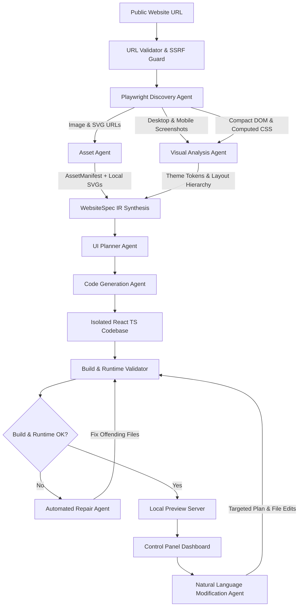

# Replicate.AI Architecture & System Design

> "Give it a URL. Get a working frontend. Modify it with AI."

Replicate.AI is an autonomous multi-stage engineering agent designed to inspect public websites and reconstruct them as **independent, standalone React/Next.js applications**.

Critically, **the output is never an iframe or proxy of the original website**. Instead, the agent extracts visual tokens, layouts, and DOM semantics to generate fresh, maintainable React TypeScript components with Tailwind CSS.

---

## 1. System Architecture Diagram



---

## 2. Multi-Stage Agent Pipeline

Rather than issuing a monolithic prompt ("Clone this website"), Replicate.AI partitions the reconstruction into 8 specialized agents:

| Stage | Agent | Responsibility |
|---|---|---|
| **1** | **Discovery Agent** | Runs headless Playwright Chromium. Renders desktop (1440x900) and mobile (390x844) viewports. Extracts sanitized DOM and computed style properties. |
| **2** | **DOM/Visual Analysis Agent** | Detects layout composition, section boundaries, typography hierarchy, and color palettes. |
| **3** | **Asset Agent** | Downloads publicly accessible images and SVGs into `public/assets/`. If blocked or missing, generates vector SVG fallbacks with matching dimensions. |
| **4** | **UI Planning Agent** | Formulates the strict **`WebsiteSpec`** Intermediate Representation (IR), detailing component hierarchy, tokens, and responsive behavior. |
| **5** | **Code Generation Agent** | Generates an independent React 18 + TypeScript + Tailwind CSS application inside an isolated directory with clean component boundaries. |
| **6** | **Build & Validation Agent** | Compiles TypeScript and runs production build. Tests local preview server via HTTP, captures runtime screenshots, and computes visual similarity. |
| **7** | **Repair Agent** | If build or runtime errors occur, inspects error diagnostics, modifies offending files, and re-validates (up to 3 iterations). |
| **8** | **Modification Agent** | Interprets natural language user instructions (e.g. "Make the navbar sticky", "Change primary color to blue"), produces a targeted modification plan, updates only affected files, and creates version snapshots. |

---

## 3. Intermediate Representation (`WebsiteSpec`)

The `WebsiteSpec` is the formal contract decoupling website inspection from frontend code generation.

```json
{
  "url": "https://example.com",
  "title": "Platform Name",
  "description": "Meta description",
  "viewport": {
    "desktop": { "width": 1440, "height": 900 },
    "tablet": { "width": 768, "height": 1024 },
    "mobile": { "width": 390, "height": 844 }
  },
  "theme": {
    "primaryColor": "#2563eb",
    "secondaryColor": "#4f46e5",
    "backgroundColor": "#ffffff",
    "textColor": "#0f172a",
    "fontFamily": "Inter, sans-serif",
    "borderRadius": "0.5rem",
    "shadows": "0 4px 6px -1px rgb(0 0 0 / 0.1)"
  },
  "navigation": {
    "brandName": "Platform",
    "items": [{ "label": "Features", "href": "#features" }],
    "cta": { "label": "Get Started", "href": "#cta", "variant": "primary" }
  },
  "sections": [
    {
      "id": "hero",
      "type": "hero",
      "order": 1,
      "heading": "Heading Text",
      "subheading": "Subheading Text",
      "buttons": [{ "label": "Start Free", "variant": "primary", "href": "#" }],
      "images": [{ "url": "/assets/hero.jpg", "alt": "Hero" }],
      "layout": "split",
      "responsiveBehavior": "stack-on-mobile"
    }
  ],
  "assets": [],
  "components": [],
  "responsiveRules": [],
  "designTokens": {}
}
```

---

## 4. Security & SSRF Protection

1. **Scheme Allowlist**: Only `http://` and `https://` are permitted. Schemes such as `file://`, `javascript:`, `data:`, `ftp:` are blocked.
2. **IP / Metadata Boundary**: Rejects requests targeting loopback addresses (`127.0.0.1`, `localhost`), private RFC 1918 subnets (`10.0.0.0/8`, `172.16.0.0/12`, `192.168.0.0/16`, `169.254.0.0/16`), and cloud metadata IP (`169.254.169.254`).
3. **Isolated Project Sandboxing**: Generated code is isolated in separate directories (`generated/projects/{id}`) with zero shell injection vectors.

---

## 5. Cost Control & Token Efficiency

- **DOM Preprocessing**: Strips `<script>`, `<style>`, trackers, and hidden tags before sending context to LLMs.
- **Provider Abstraction**: Supports OpenAI, Anthropic, Gemini, Groq, and local Ollama models.
- **Offline Heuristic Engine**: Full pipeline operates autonomously with built-in AST code synthesis even if external LLM APIs are offline.
- **Targeted Modifications**: Natural language modifications alter only affected files, avoiding expensive full-project regeneration.
